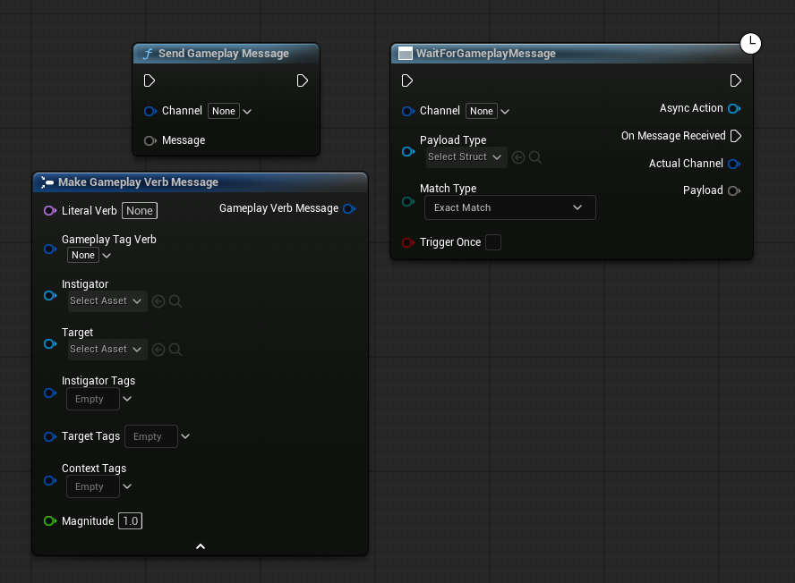

# Gameplay Message Subsystem

Works for my UE 5.7 project.

I copied from the Lyra project and changed a bit.  
I think there's a version inside unreal now, so I think that's why it's called the Gameplay Message Router.

# What I Have Changed

I have renamed the nodes to be in-line with the naming of Gameplay Ability System.  
So:  
Listen For Gameplay Message → Wait For Gameplay Message  
Broadcast Message → Send Gameplay Message

And I made it so you don't need to use the Get Subsystem node before sending a message.

Also, I've updated the Gameplay Message Struct to contain a FName variable.

